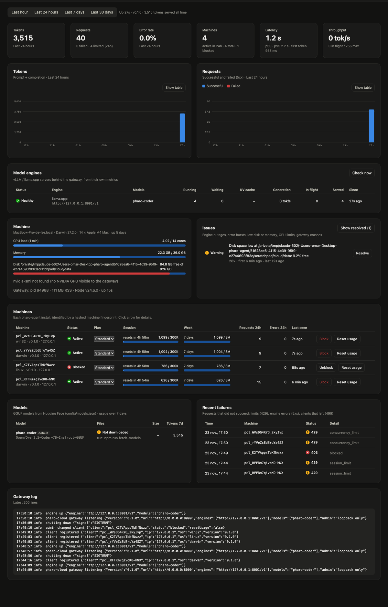

# Pharo Cloud

Hosted models for [pharo-agent](https://github.com/pharo-llm/pharo-agent).
pharo-agent is the harness on your machine. Pharo Cloud is the machine that runs
the model.

- **Models from Hugging Face, in GGUF**, downloaded once and served by
  **vLLM**, which batches many requests in parallel (llama.cpp is an alternative engine).
- **No login.** pharo-agent registers your machine automatically. It gets a
  client ID tied to a *hashed* machine fingerprint, so reinstalling doesn't
  reset its limits.
- **Usage limits like Claude's:** tokens per 5-hour session and per week, plus
  requests per minute and requests at once. Over a limit, you get a clear
  message with the exact reset time.
- **An admin dashboard** shows everything about the machine: token usage,
  machines, engines, GPU / CPU / memory / disk, issues, failures and logs. It
  also lets the admin block a machine, change its plan or reset its usage.



## How It Fits Together

```text
pharo-agent ──HTTPS──► gateway :8000 ──► vLLM (GPU)  ◄── GGUF from Hugging Face
  (your machine)        limits, metering,   continuous batching,
                        admin dashboard     tensor parallel
```

The gateway is the only public port. The engine is never exposed, and only
the gateway knows its API key. See [docs/ARCHITECTURE.md](docs/ARCHITECTURE.md).

## Run It On A GPU Machine

Needs Docker with the NVIDIA Container Toolkit.

```sh
cp deploy/.env.example deploy/.env      # set the engine key and an admin token
docker compose -f deploy/docker-compose.yml up -d --build
```

The first start downloads the model from Hugging Face (and merges a split GGUF
into one file, which vLLM needs). Then vLLM loads it, and the gateway answers on
port 8000. Choose the model in `config/models.json` and the limits in
`config/plans.json`. Operating it (TLS, updates, backups, troubleshooting):
[docs/OPERATIONS.md](docs/OPERATIONS.md).

## Admin Dashboard

`http://<machine>:8000/admin`. It opens without a password from the machine
itself, or through an SSH tunnel:

```sh
ssh -L 8000:127.0.0.1:8000 you@gpu-machine     # then open http://127.0.0.1:8000/admin
```

From anywhere else it asks for `PHARO_CLOUD_ADMIN_TOKEN`.

## Use It From pharo-agent

`pharo-agent setup` → **Pharo Cloud**. Nothing else is needed. In the chat, `/usage`
shows your session and weekly usage. Any OpenAI-compatible client works too.
See [docs/API.md](docs/API.md).

## Develop

Node.js 22.13 or newer. There are no dependencies.

```sh
npm test                                   # gateway tests (fake engine)
PHARO_CLOUD_UPSTREAMS=http://127.0.0.1:8001/v1 npm start
llama-server -m model.gguf --port 8001 --parallel 4 --metrics --alias pharo-coder   # a local engine
```
